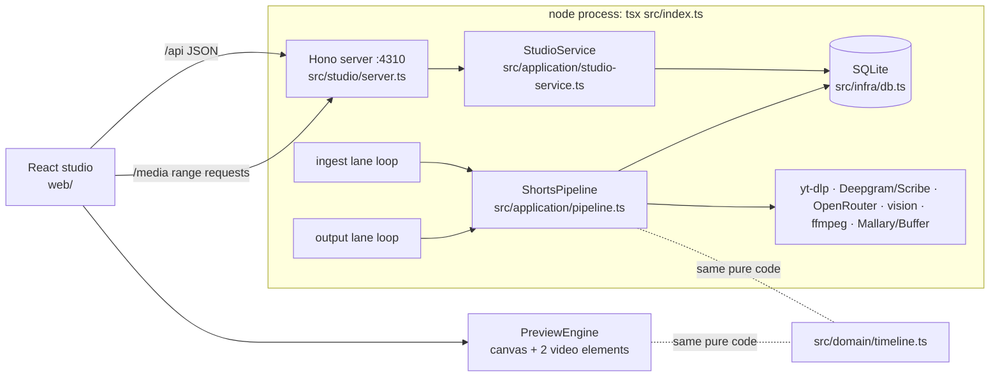

# Shorts studio and production upgrade

Status: approved direction, implementation in progress.

## Decisions (user-confirmed)

- Telegram is removed. A local web studio (localhost only, no auth, bind `127.0.0.1`) is the only interface.
- Edits preview live in the browser. ffmpeg runs only on export.
- Production upgrades, all in: hook headline band, bold word-highlight captions, smart content crop (vision), cut pauses and fillers, punch-in zooms. Always: 1080×1920 @ 30 fps, loudness normalization (-14 LUFS), click-free cuts.

## Models (OpenRouter)

Picked from the OpenRouter catalog; both are env-configurable.

| Role | Env var | Default | Price per 1M tokens (in / out) | Why |
|---|---|---|---|---|
| Editorial (semantic blocks, opportunities, plan, hooks, revisions, publish copy) | `OPENROUTER_MODEL` + `OPENROUTER_REASONING_EFFORT` + `OPENROUTER_MAX_TOKENS` | `deepseek/deepseek-v4.1-flash` at `max`, 128000 tokens | $0.15 / $0.60 | Fastest option in the planning benchmark below; hook suggestions return in ~4 s. Replaced `anthropic/claude-haiku-5.5` at `max`, which in one of two full planning runs spent its whole 128k-token budget reasoning on two of the three calls and returned nothing. |
| Vision crops | `OPENROUTER_VISION_MODEL` | `google/gemini-3.8-flash` | $0.83 / $4.12 | Gemini models return native `box_2d` grounding; ~$0.002 per frame. Vision calls send no reasoning effort. |

`OPENROUTER_REASONING_EFFORT` (`max` | `xhigh` | `high` | `medium` | `low` | `minimal` | `none`) goes out as OpenRouter's unified `reasoning.effort` on editorial calls only, together with `max_tokens = OPENROUTER_MAX_TOKENS`. Every request sends `provider: { require_parameters: true }` so OpenRouter only routes to endpoints that support structured outputs and reasoning; a response that ends with `finish_reason: "error"` (provider failure) is retried once, while `length` is not.

Full planning benchmark (semantic blocks → opportunities → candidate plan) on the same 24-minute Filipe Boni transcript, 2026-10-17:

| Model, effort | Result | Total time | Cost | Shorts |
|---|---|---|---|---|
| `deepseek/deepseek-v4.1-flash`, `max` | ok (3 calls, 55 s / 90 s / 127 s) | 4.5 min | $0.064 | 4, 49–64 s |
| `anthropic/claude-haiku-5.5`, `xhigh` | ok (151 s / 146 s / 163 s) | 7.7 min | $0.063 | 5, 50–64 s |
| `anthropic/claude-haiku-5.5`, `max` | 1 of 2 runs ok (21 min, $0.17); the other exhausted all 128k tokens reasoning on blocks and on the plan | — | — | — |

An earlier DeepSeek run failed once with a provider-side `finish_reason: "error"`; that case is now retried.

## Architecture



The key parity rule: `buildTimeline()` in `src/domain/timeline.ts` is the single source of truth for cuts, crops, zooms, caption cues, and hook lines. The browser preview and the ffmpeg renderer both consume a `Timeline`; neither recomputes geometry or caption layout on its own.

Domain files shared with the browser (`src/domain/{edit,timeline,geometry,text,layout,model}.ts`) must not import Node built-ins or `src/infra/*`.

## Frozen contracts (already in the repo)

Do not change these without the integration owner. Implement against them.

- `src/domain/layout.ts`: `LayoutProfile` v2, panels (`content` | `host`), `HookBandStyle`, `CaptionStyle`, `LayoutFont`, `NormRect`, `PxRect`.
- `src/domain/edit.ts`: `ShortEdit`, `WordRange`, `CropKeyframe`, `EDIT_LIMITS`, `ShortEditSchema`. Functions are appended to this file (slice S1).
- `src/domain/timeline.ts`: `Timeline`, `TimelineClip`, `CaptionCue`, `CaptionWord`, `TimelineHook`. Functions appended (S1).
- `src/domain/model.ts`: entities (`JobRecord`, `ShortRecord`, `ExportRecord`, `PublicationRecord`, `QueueTask`, `QueueTaskPayloads`, `QUEUE_LANES`), `ShortVideoPlatform`, creator profile types, LLM response schemas (`PlannedCandidateResponseSchema` now requires `hook_text`, new `RevisionIntentSchema` action set, `PublishCopyResponseSchema`, `HookSuggestionsResponseSchema`, `CropFocusResponseSchema`).
- `src/studio/api-types.ts`: DTOs, request schemas, `StudioApi`, `MEDIA_ROUTES`.
- `src/application/errors.ts`: `StudioError` (`not_found` → 404, `conflict` → 409, `invalid` → 400, `unavailable` → 503).
- `src/application/studio-media.ts`: `StudioMediaResolver`.
- `src/domain/text.ts`: `formatCaptionWord`, `wrapWords`, `wrapHook`, `parseHexColor` (implemented; shared by the timeline, the ASS writer, and the preview).

## Domain rules (S1 implements, everyone relies on them)

### Word indices

`WordRange.startWord/endWord` and `removedWords` are indices into `job.transcriptWords` (the array as stored, never re-sorted). `TranscriptSentence.startWord/endWord` are indices into the same array.

### Edit operations (append to `src/domain/edit.ts`)

```ts
export const FILLER_WORDS: ReadonlySet<string>; // 'hã','hãã','ãh','ããh','hum','humm','hmm','uhm','ahn','éh','ehh'
export function normalizeFillerToken(text: string): string; // lowercase pt-BR, strip leading/trailing punctuation
export function detectFillerWords(words: TranscriptWord[], ranges: WordRange[]): number[];
export function createInitialEdit(input: { ranges: WordRange[]; words: TranscriptWord[]; speed: number; hookText: string }): ShortEdit;
export function normalizeEdit(edit: ShortEdit, wordCount: number): ShortEdit;
export function keptWordIndices(edit: ShortEdit, wordCount: number): number[];
export function keptText(edit: ShortEdit, words: TranscriptWord[]): string;
export function addRange(edit: ShortEdit, range: WordRange, wordCount: number): ShortEdit;
export function removeRangeAt(edit: ShortEdit, rangeIndex: number, wordCount: number): ShortEdit;
export function setRangeBoundary(edit: ShortEdit, rangeIndex: number, side: 'start' | 'end', wordIndex: number, wordCount: number): ShortEdit;
export function setWordsRemoved(edit: ShortEdit, fromWord: number, toWord: number, removed: boolean, wordCount: number): ShortEdit;
export function trimStartBySeconds(edit: ShortEdit, words: TranscriptWord[], seconds: number): ShortEdit;
export function extendStartBySeconds(edit: ShortEdit, words: TranscriptWord[], seconds: number): ShortEdit;
export function trimEndBySeconds(edit: ShortEdit, words: TranscriptWord[], seconds: number): ShortEdit;
export function extendEndBySeconds(edit: ShortEdit, words: TranscriptWord[], seconds: number): ShortEdit;
export function upsertCropKeyframe(edit: ShortEdit, keyframe: CropKeyframe): ShortEdit;
export function removeCropKeyframe(edit: ShortEdit, sourceSeconds: number): ShortEdit;
export function replaceAutoCrops(edit: ShortEdit, keyframes: CropKeyframe[]): ShortEdit;
```

Rules:
- All operations are pure and return a normalized edit.
- `normalizeEdit`: throws `Error` if any range index is `>= wordCount`; sorts ranges by `startWord`; merges overlapping or adjacent ranges (`next.startWord <= prev.endWord + 1`); `removedWords` sorted, unique, and filtered to indices inside some range; crops sorted by `sourceSeconds`, deduped (later wins) when within 0.05 s; clamps `speed`, `tightenPauses.maxGapSeconds`, `zoom.strength` into `EDIT_LIMITS`; trims `hook.text`.
- `createInitialEdit`: `removedWords = detectFillerWords(words, ranges)`, `tightenPauses = { enabled: true, maxGapSeconds: EDIT_LIMITS.defaultPauseGapSeconds }`, `speed` clamped, `hook = { enabled: hookText.trim().length > 0, text: hookText.trim().slice(0, 90) }`, `captions.enabled = true`, `crops = []`, `zoom = { enabled: true, strength: EDIT_LIMITS.defaultZoom }`, `endCard.enabled = false`.
- `removeRangeAt` throws `Error('A short needs at least one range')` when removing the last range.
- `setRangeBoundary`: moving `start` past `end` (or vice versa) throws `Error`. Result is normalized (may merge with neighbours).
- `setWordsRemoved(removed=false)` only un-strikes; it never adds ranges. `removed=true` only affects indices inside ranges.
- Seconds-based ops move the first range's start (or last range's end) by whole words: trim moves inward until the accumulated distance between the original boundary word start (end) and the new boundary word start (end) is `>= seconds`, never past the opposite boundary of that range; extend moves outward the same way, stopping at index 0 / `words.length - 1`.
- `upsertCropKeyframe` replaces any keyframe within 0.05 s of `keyframe.sourceSeconds`. `replaceAutoCrops` drops every `origin: 'auto'` keyframe and inserts the given ones, keeping `manual` keyframes (a manual keyframe within 0.05 s of an auto one wins).

### Timeline (append to `src/domain/timeline.ts`)

```ts
export const CLIP_PAD_IN_SECONDS = 0.08;
export const CLIP_PAD_OUT_SECONDS = 0.12;
export const CROP_SPLIT_MARGIN_SECONDS = 0.3;
export const END_CARD_SECONDS = 2.4;
export const CUE_GAP_BREAK_SECONDS = 0.6;
export const CUE_TAIL_SECONDS = 0.25;

export interface SourceClip { sourceStart: number; sourceEnd: number; joinsPrevious: boolean; firstWord: number; lastWord: number }
export function computeSourceClips(edit: ShortEdit, words: TranscriptWord[], sourceDurationSeconds: number): SourceClip[];
export function outputDurationSeconds(edit: ShortEdit, words: TranscriptWord[], sourceDurationSeconds: number): number;
export function buildTimeline(input: { edit: ShortEdit; words: TranscriptWord[]; layout: LayoutProfile; source: { width: number; height: number; durationSeconds: number }; title: string }): Timeline;
export function outputToSource(timeline: Timeline, outputSeconds: number): { clipIndex: number; sourceSeconds: number };
export function sourceToOutput(timeline: Timeline, sourceSeconds: number): number | null;
export function activeCueAt(timeline: Timeline, outputSeconds: number): { cue: CaptionCue; activeWordIndex: number | null } | null;
```

`computeSourceClips`:
1. `kept = keptWordIndices(edit, words.length)`. Empty → `[]`.
2. Walk `kept`; start a new group when `kept[k] !== kept[k-1] + 1`, or when `edit.tightenPauses.enabled` and `words[kept[k]].startSeconds - words[kept[k-1]].endSeconds > edit.tightenPauses.maxGapSeconds`.
3. For a group with first word `f`, last word `l`:
   - `prevEnd = f > 0 ? words[f-1].endSeconds : 0`; `sourceStart = max(words[f].startSeconds - PAD_IN, (prevEnd + words[f].startSeconds) / 2, 0)`.
   - `nextStart = l + 1 < words.length ? words[l+1].startSeconds : sourceDurationSeconds`; `sourceEnd = min(words[l].endSeconds + PAD_OUT, (words[l].endSeconds + nextStart) / 2, sourceDurationSeconds)`.
   - `joinsPrevious = previousClip !== undefined && Math.abs(sourceStart - previousClip.sourceEnd) < 0.001`.
4. Clips are strictly chronological and non-overlapping by construction.

`buildTimeline`:
1. Clips from `computeSourceClips`, then split each clip at every crop keyframe time `t` with `clip.sourceStart + 0.3 < t < clip.sourceEnd - 0.3`. Sub-clips after a split have `joinsPrevious: true` and look up their crop with `<= sourceStart`. Every clip is then snapped to a whole number of output frames (`frames = round((sourceEnd - sourceStart) / speed * fps)`, `sourceEnd` adjusted; 0-frame clips dropped) so the preview, the ASS file, and ffmpeg agree to the frame.
2. Output times: `outputStart` cumulative, duration `(sourceEnd - sourceStart) / edit.speed`.
3. Zoom: if `edit.zoom.enabled`, a toggle flips at every clip with `joinsPrevious === false` except the first; clip zoom = toggle ? `edit.zoom.strength` : 1. Disabled → 1 everywhere.
4. Crop focus per clip: the last keyframe with `sourceSeconds <= clip.sourceStart + 0.3`; none → `null`.
5. Panels per clip, in layout order, via `src/domain/geometry.ts`:
   - canvas px = `panelCanvasRect(panel, layout.canvas)`; aspect = `canvas.w / canvas.h`.
   - content → `contentSourceCrop(panel, focus, source, aspect)`; host → `hostSourceCrop(panel, zoom, source, aspect)`.
6. Captions (when `edit.captions.enabled`): caption words for every kept word, `text = formatCaptionWord(word.text, style.uppercase)`, times mapped with the clip chain (`outputStart + (t - clip.sourceStart) / speed`, clamped to the clip). Drop words with empty text. Cue building is greedy: start a new cue when the current cue has `maxWordsPerCue` words, when greedy wrapping into `maxCharsPerLine` would need more than `maxLines` lines, when the gap from the previous word end is `> CUE_GAP_BREAK_SECONDS`, or when the previous word ends with `. ! ? …`. `cue.lines = wrapWords(...)` grouped as `CaptionWord[][]`. `cue.outputEnd = min(lastWord.outputEnd + CUE_TAIL_SECONDS, nextCue.outputStart)`.
7. Hook: `edit.hook.enabled && layout.hookBand && text.trim()` → `{ lines, sizePx, canvas }`. Auto-fit tries `sizePx`, `round(sizePx * 0.86)`, `round(sizePx * 0.74)` with `maxCharsPerLine` scaled by `sizePx / size`, and takes the first size whose wrap fits `maxLines` (else the smallest). The UI warns when even the smallest overflows.
8. `endCard` (when `edit.endCard.enabled`) carries the full end-card layout: duration (`END_CARD_SECONDS`), darkening factor, thumbnail rect, wrapped `input.title` lines with positions and sizes, the "Link na descrição" CTA, and `audio`. Preview and export both draw from it. `durationSeconds` excludes the end card. `audio` continues the source right after the last clip (`sourceStart = lastClip.sourceEnd`, `sourceEnd = min(source duration, sourceStart + END_CARD_SECONDS × speed)`, `null` when the last clip reaches the source end) under the gain envelope `endCardAudioGain`: linear duck from 1 to 0.35 over the first 0.5 s, hold, linear fade to 0 over the last 1 s. The last clip skips its fade-out when this audio follows it, so speech runs on without a click.

`activeCueAt`: cue with `outputStart <= t < outputEnd`; `activeWordIndex` = position in the flattened cue words of the last word with `outputStart <= t` (null before the first word).

### Geometry (`src/domain/geometry.ts`, new)

```ts
export interface Rect { x: number; y: number; w: number; h: number }
export const MAX_CONTENT_ZOOM = 2.5;
export function normToPx(rect: NormRect, width: number, height: number): Rect;
export function toEvenPxRect(rect: Rect): PxRect; // x,y floor to even; w,h floor to even, min 2
export function fitRectToAspect(focus: Rect, aspect: number, bounds: Rect, minWidth: number): Rect;
export function panelCanvasRect(panel: LayoutPanel, canvas: { width: number; height: number }): PxRect;
export function contentSourceCrop(panel: ContentPanel, focus: NormRect | null, source: { width: number; height: number }, aspect: number): PxRect;
export function hostSourceCrop(panel: HostPanel, zoom: number, source: { width: number; height: number }, aspect: number): PxRect;
```

`fitRectToAspect`: expand the shorter side of `focus` around its center to reach `aspect`; if `w < minWidth` grow to `minWidth` (keeping aspect); if `w > bounds.w` shrink to `bounds.w`; if `h > bounds.h` shrink to `bounds.h` (keeping aspect each time); center on the focus center; clamp inside `bounds`.

Content: `bounds = normToPx(panel.sourceRect)`, `focus = focus ? normToPx(focus) : bounds`, `minWidth = bounds.w / MAX_CONTENT_ZOOM`, then `toEvenPxRect`.

Host: `bounds = normToPx(panel.sourceRect)`; anchor px = `bounds.x + anchor.x * bounds.w`, `bounds.y + anchor.y * bounds.h`; base = largest rect of `aspect` that fits in `bounds`, centered on the anchor and clamped; zoomed = base scaled by `1 / zoom` around the anchor, clamped inside `bounds`; `toEvenPxRect`.

### Text (`src/domain/text.ts`, already implemented)

```ts
export function formatCaptionWord(text: string, uppercase: boolean): string; // collapse whitespace, trim, toLocaleUpperCase('pt-BR') when uppercase
export function wrapWords(words: string[], maxCharsPerLine: number): number[][]; // greedy; returns word indices per line; a word longer than the limit gets its own line
export function wrapHook(text: string, style: HookBandStyle): string[];
export function parseHexColor(hex: string): { r: number; g: number; b: number; a: number }; // '#RRGGBB' or '#RRGGBBAA', a in 0..1; throws on anything else
```

## Layout v2 profiles

`profiles/filipe_boni_layout.json` (screen share top, host bottom, red hook band):

```json
{
  "version": 2,
  "creatorId": "filipe_boni",
  "layoutId": "screen-top-host-bottom-v2",
  "canvas": { "width": 1080, "height": 1920, "fps": 30 },
  "background": "#101010",
  "defaultSpeed": 1.1,
  "font": { "family": "Montserrat ExtraBold", "file": "assets/fonts/Montserrat-ExtraBold.ttf", "assSizeScale": 1.562 },
  "panels": [
    { "id": "screen", "role": "content", "sourceRect": { "x": 0, "y": 0, "w": 0.632, "h": 1 }, "canvasRect": { "x": 0, "y": 0.1146, "w": 1, "h": 0.4375 } },
    { "id": "host", "role": "host", "sourceRect": { "x": 0.637, "y": 0, "w": 0.363, "h": 1 }, "canvasRect": { "x": 0, "y": 0.5521, "w": 1, "h": 0.4479 }, "anchor": { "x": 0.5, "y": 0.42 } }
  ],
  "hookBand": { "rect": { "x": 0, "y": 0, "w": 1, "h": 0.1146 }, "background": "#C8102E", "textColor": "#FFFFFF", "sizePx": 58, "maxCharsPerLine": 24, "maxLines": 2, "uppercase": true },
  "captions": { "sizePx": 62, "textColor": "#FFFFFF", "highlightColor": "#FFD400", "outlineColor": "#000000", "outlinePx": 6, "shadowPx": 2, "uppercase": true, "maxWordsPerCue": 4, "maxCharsPerLine": 16, "maxLines": 2, "centerY": 0.5521 }
}
```

`profiles/jones_manoel_layout.json` (single centered host crop):

```json
{
  "version": 2,
  "creatorId": "jones_manoel",
  "layoutId": "center-speaker-vertical-v2",
  "canvas": { "width": 1080, "height": 1920, "fps": 30 },
  "background": "#101010",
  "defaultSpeed": 1.0,
  "font": { "family": "Montserrat ExtraBold", "file": "assets/fonts/Montserrat-ExtraBold.ttf", "assSizeScale": 1.562 },
  "panels": [
    { "id": "speaker", "role": "host", "sourceRect": { "x": 0.342, "y": 0, "w": 0.316, "h": 1 }, "canvasRect": { "x": 0, "y": 0, "w": 1, "h": 1 }, "anchor": { "x": 0.5, "y": 0.4 } }
  ],
  "hookBand": { "rect": { "x": 0.05, "y": 0.07, "w": 0.9, "h": 0.11 }, "background": "#000000B3", "textColor": "#FFFFFF", "sizePx": 56, "maxCharsPerLine": 24, "maxLines": 2, "uppercase": true },
  "captions": { "sizePx": 64, "textColor": "#FFFFFF", "highlightColor": "#FFD400", "outlineColor": "#000000", "outlinePx": 6, "shadowPx": 2, "uppercase": true, "maxWordsPerCue": 4, "maxCharsPerLine": 16, "maxLines": 2, "centerY": 0.72 }
}
```

`assSizeScale = (OS/2 winAscent + winDescent) / unitsPerEm = (1109 + 453) / 1000` for the bundled Montserrat ExtraBold. libass sizes fonts by win metrics, the browser by em, so ASS `Fontsize = round(sizePx * assSizeScale)`.

`profiles/creator-profiles.json` becomes manifest `version: 2`: drop every `telegram` block, drop `snapshotLayoutInJobs`, keep `render.layoutPath` + `render.layoutId` (`screen-top-host-bottom-v2`, `center-speaker-vertical-v2`), publish modes `global` / `disabled` only (drop `provider`, `fallbackToGlobal`, `configRef`).

## Slices

Each slice owns its files. Do not edit files owned by another slice. Do not run build, typecheck, or tests mid-flight; run your slice's own tests once at the end and report. The integration owner runs the full typecheck after all slices land.

### S1 domain (owner: DomainCore)

Files: `src/domain/edit.ts` (append functions), `src/domain/timeline.ts` (append functions), `src/domain/geometry.ts` (new), `src/domain/policies.ts`, `tests/edit.test.ts` (new), `tests/timeline.test.ts` (new), `tests/policies.test.ts`.

- Implement everything in "Domain rules".
- `policies.ts`: keep only `buildSentences` and `detectStrongSpeakers`. `buildSentences` must populate `startWord/endWord` as indices into the input `words` array (track original indices before filtering/sorting). Delete `buildCandidateVersion`, `validateCandidate`, `markDraftReady`, `rejectCandidate`, `applyRevision`, `applyResolvedInsert`, the contiguous plan types, and helpers only they use. `policies.ts` must not import `src/infra/*` anymore.
- Tests (behaviour, not wiring): pause tightening splits at gaps > threshold and not below; removed words produce cuts that never include the removed word's audio; padding never crosses the midpoint to a neighbour word; speed scales output times; crop split creates `joinsPrevious` sub-clips; zoom alternates only at real cuts; geometry keeps aspect, stays inside bounds, respects `MAX_CONTENT_ZOOM`, even px; cue breaking on punctuation, gap, max words, line overflow; `outputToSource`/`sourceToOutput` round-trip; `normalizeEdit` merges adjacent ranges and drops out-of-range removed words; seconds-based trim/extend move by whole words and stop at bounds; `buildSentences` word indices map back to the original array when another speaker's words are interleaved.

### S2 render (owner: RenderEngine)

Files: `src/infra/render.ts` (rewrite), `src/infra/ass.ts` (new), delete `src/infra/subtitles.ts`, `tests/render.test.ts` (rewrite), delete `tests/subtitles.test.ts`.

```ts
export interface ExportRenderInput { timeline: Timeline; layout: LayoutProfile; sourceVideoPath: string; workDir: string; fontsDir: string; endCardThumbnailPath: string | null }
export interface ExportRenderResult { artifactPath: string; sizeBytes: number; durationSeconds: number }
export async function renderShortExport(input: ExportRenderInput): Promise<ExportRenderResult>;
export async function extractFrame(input: { videoPath: string; seconds: number; width: number; outputPath: string }): Promise<void>;
export function buildExportAss(input: { timeline: Timeline; layout: LayoutProfile }): string; // in ass.ts
export function buildSubtitlesFilterArg(assPath: string, fontsDir: string): string; // in render.ts, escaped for ffmpeg filter parsing
```

Stage 1, chunks: group consecutive clips into chunks; start a new chunk when `clip.sourceStart - chunk.sourceEnd > 20` or the chunk has 40 clips. Per chunk run `ffmpeg -y -ss {chunkStart} -to {chunkEnd} -i source -filter_complex ... -map [vc] -map [ac] -c:v libx264 -preset veryfast -crf 14 -pix_fmt yuv420p -r {fps} -c:a pcm_s16le -ar 48000 chunk_{k}.mkv` with:
- `[0:v]split={N}` and `[0:a]asplit={N}`; trims relative to `chunkStart`.
- Clip video: `trim=start=a:end=b,setpts=(PTS-STARTPTS)/{speed},fps={fps},split={P}`; per panel `crop={w}:{h}:{x}:{y},scale={cw}:{ch}:flags=lanczos,setsar=1`; overlay chain onto `color=c={background}:s={W}x{H}:r={fps}:d={clipOutputDuration}` at the panel canvas x/y; end with `format=yuv420p`.
- Clip audio: `atrim=start=a:end=b,asetpts=PTS-STARTPTS`, then `atempo={speed}` only when speed ≠ 1, then `afade=t=in:st=0:d=0.015` when `!joinsPrevious`, and `afade=t=out:st={dur-0.015}:d=0.015` when the next clip does not join (or it is the last clip).
- `concat=n={N}:v=1:a=1[vc][ac]` (concat realigns A/V at every segment, so rounding never accumulates).

Stage 2, final: concat-demux the chunk files; burn `buildExportAss` via `ass=filename=...:fontsdir=...`; if `endCard`, render a 2.4 s end card mkv with the same params (blurred, darkened source frame at the last clip end scaled to cover, thumbnail at 900 px wide centered around y≈560 when present, title wrapped ≤ 3 lines and "Link na descrição" drawn through a small ASS file with the layout font; audio from `endCard.audio` with `atempo` and a `volume` expression matching `endCardAudioGain`, padded to the card length, or `anullsrc` when `audio` is null) and append with the concat filter; then `loudnorm=I=-14:TP=-1.5:LRA=11,aresample=48000`; encode `-c:v libx264 -preset medium -crf 20 -profile:v high -pix_fmt yuv420p -r {fps} -c:a aac -b:a 160k -ar 48000 -movflags +faststart {workDir}/short.mp4`. Duration from ffprobe. Intermediate files stay in `workDir`. The preview plays the same source span on the standby video element with `volume = endCardAudioGain(...)` while the active element holds the background frame.

ASS (`buildExportAss`): `PlayResX/Y` = canvas, `ScaledBorderAndShadow: yes`, `WrapStyle: 2`. Colors via `parseHexColor` → `&HAABBGGRR` with inverted alpha. Styles: `Band` (drawing), `Hook` (font family, `round(hookBand.sizePx * assSizeScale)`, no outline), `Caption` (`round(captions.sizePx * assSizeScale)`, `BorderStyle=1`, `Outline=outlinePx`, `Shadow=shadowPx`, `Bold=0`, `Alignment=5`). Events:
- Band: layer 0, `0 → timeline.durationSeconds`, `{\an7\pos(0,0)\p1}m x y l x+w y l x+w y+h l x y+h{\p0}` with band color/alpha.
- Hook: layer 1, same span, `{\an5\pos(cx,cy)}` lines joined by `\N`.
- Captions: layer 2. For each cue and each word k of the flattened cue: one event from `k === 0 ? cue.outputStart : word.outputStart` to `k === last ? cue.outputEnd : nextWord.outputStart`; text = all cue lines joined by `\N`, active word wrapped in `{\c&H..&}word{\c&H..&}` (highlight then text color); position `{\an5\pos(W/2, round(captions.centerY * H))}`. Escape `\`, `{`, `}` in words.

Tests: ASS output (one visible caption event at any time, active word colored, correct font sizes from `assSizeScale`, band/hook only when `timeline.hook`), filter-arg escaping. Smoke the full render with a hand-built `Timeline` against `/tmp/fb/sec_*.mp4` style inputs in a throwaway script under `/tmp`, not the repo.

### S3 source and planning infra (owner: SourcePlanning)

Files: `src/infra/youtube.ts`, `src/infra/openrouter.ts`, `src/domain/semantic.ts`, `src/infra/layout.ts`, `src/infra/creator-profile-loader.ts`, `profiles/*.json`, `tests/youtube.test.ts`, `tests/openrouter.test.ts`, `tests/semantic.test.ts`, `tests/creator-profile-loader.test.ts`.

- `youtube.ts`: `downloadSource(outDir, url, options): Promise<{ title: string; media: SourceMedia }>`. Format: `bv*[height<=1080][vcodec^=avc1]+ba[ext=m4a]/b[ext=mp4][vcodec^=avc1]/bv*[height<=1080]+ba/b` (H.264 decodes and seeks fast in both ffmpeg and the browser; ffmpeg 6.1 asserts on some AV1 streams). Probe width, height, fps (`r_frame_rate`), duration with ffprobe. Files: `source.mp4`, `source.m4a`, `thumbnail.jpg`. Remove the dead `rename` of identical paths. Keep `assertPublicYouTubeUrl`, `buildYtDlpArgs` (update its format string and its test).
- `openrouter.ts`:
  - Export `requestStructuredJson<T>(config, { title, system, userText, images?: Array<{ mimeType: 'image/jpeg' | 'image/png'; base64: string }>, model?: string, temperature, responseFormat: { name; schema }, parse: (value: unknown) => T }): Promise<T>` with the existing extract + one JSON-repair pass. With images, the user message content is `[{ type: 'text', text }, { type: 'image_url', image_url: { url: 'data:<mime>;base64,<b64>' } }...]`. `model` defaults to `config.OPENROUTER_MODEL`. Rewire every client method onto it. Change the `HTTP-Referer` header to `http://127.0.0.1` and keep `X-Title` = task title.
  - Planner (`findOpportunities`, `repairOpportunityPlan`, `planCandidates`): add required `hook_text` to the JSON schemas and normalizers, and to the prompts: "hook_text: manchete curta (até ~60 caracteres, máx. 90) para a faixa no topo do short; provocativa, específica, sem clickbait vazio, em PT-BR". Add to `planCandidates` rules: "O primeiro bloco precisa prender nos primeiros 3 segundos sem depender de contexto anterior."
  - `parseRevision(input: { title: string; hookText: string; durationSeconds: number; segments: Array<{ start_seconds: number; end_seconds: number; text: string }>; message: string }): Promise<RevisionIntent>` with the new action set (`retitle`, `set_hook`, `trim_start`, `trim_end`, `extend_start`, `extend_end`, `insert_span`, `remove_span`, `set_speed` 1..1.5, `enable_end_card`, `disable_end_card`). Update the JSON schema, prompt, and alias normalizer (drop `caption_cleanup`, `reorder_candidate`; map `enable_preview_end_card`→`enable_end_card` etc.; speed default 1.15 clamped to [1, 1.5]).
  - `suggestHooks(input: { title: string; summary: string; transcriptText: string; current: string }): Promise<string[]>` → exactly 3 options (`HookSuggestionsResponseSchema`).
  - `writePublishCopy(input: { title: string; summary: string; hook: string; payoff: string; rationale: string; quotes: string[] }): Promise<PublishCopyResponse>` replaces `writeInstagramReelDescription` (same rules/prompt).
  - Keep `buildSemanticBlocks`, `locateTranscriptSpan` (+ lexical fallback).
- `semantic.ts`: keep fallback blocks, materialize, usability check, opportunity mapping, diagnostics. Replace `buildCandidateVersionFromBlocks`/`validateCandidateFromBlocks` with `buildPlannedShorts(input: { sentences: TranscriptSentence[]; blocks: SemanticBlock[]; plan: PlannedCandidateResponse; speed: number }): PlannedShort[]` where `PlannedShort = { title; summary; hook; hookText; payoff; rationale; risk; arc: CandidateArc | null; ranges: WordRange[]; rawDurationSeconds: number }` (exported from `semantic.ts`). Ranges come from merged block spans via `sentence.startWord/endWord`. Max 5, deduped by range signature. Duration limits become `[30, 180]` s raw (YouTube Shorts caps at 3 minutes). Delete `buildArcPreviewSvg`. `semantic.ts` must not import `src/infra/*`.
- `layout.ts`: only `loadLayoutProfile(path, rootDir): Promise<LayoutProfile>` with a strict zod schema for v2 (rects 0..1, `w/h > 0`, `x + w <= 1`, `y + h <= 1`, colors `#RRGGBB(AA)`, `defaultSpeed` 1..1.5, ≥ 1 panel, at most one content panel and one host panel). Delete `buildLayoutFilter`.
- `creator-profile-loader.ts`: manifest v2 schema (no `telegram`, no legacy). Remove `legacy_default`, legacy static layout, chat defaults, strict flags. API:
  ```ts
  export class CreatorProfileRepository {
    constructor(options: { rootDir: string; manifestPath: string });
    getManifest(): Promise<CreatorProfileManifest>;
    getEnabledCreatorProfiles(): Promise<CreatorProfile[]>;
    getCreatorProfileById(id: string): Promise<CreatorProfile | null>;
    resolveCreatorProfile(input: { requestedId?: string; studioDefaultId?: string | null }): Promise<{ profile: CreatorProfile; layout: LayoutProfile }>;
  }
  export function publishConfigForPlatform(profile: CreatorProfile, platform: ShortVideoPlatform): CreatorPlatformPublishConfig;
  ```
  Precedence: `requestedId` (must exist and be enabled, else throw `StudioError('invalid', ...)`), then `studioDefaultId` if it exists and is enabled, then `manifest.defaultCreatorId`, then first enabled, else throw. Validation keeps duplicate ids and layout `creatorId`/`layoutId` match checks. Missing platform publish config → `{ mode: 'disabled' }`.
- Update the four test files to the new behaviour; delete tests that only exercised removed code.

### S4 vision crops (owner: VisionCrops)

Files: `src/infra/vision.ts` (new), `tests/vision.test.ts` (new, pure parts only).

```ts
export async function detectSceneTimes(input: { videoPath: string; region: PxRect; startSeconds: number; endSeconds: number; threshold?: number }): Promise<number[]>;
export async function analyzeContentCrops(input: {
  config: AppConfig;
  videoPath: string;
  source: { width: number; height: number };
  panel: ContentPanel;
  spans: Array<{ startSeconds: number; endSeconds: number; text: string }>;
  words: TranscriptWord[];
  workDir: string;
}): Promise<CropKeyframe[]>;
export function boxToSourceFocus(box: [number, number, number, number], panel: ContentPanel): NormRect; // box_2d [ymin, xmin, ymax, xmax] 0..1000 relative to the panel region
```

- Scene detection: `ffmpeg -ss S -to E -i video -an -vf "crop=w:h:x:y,scale=480:-2,select='gt(scene,0.18)',showinfo" -f null -`; parse `pts_time:` from stderr; absolute = `S + pts_time`. Samples per span = `[S, ...scenes]`, merged when < 2 s apart, max 8 per span, 16 total.
- Per sample `t`: frame at `min(t + 0.5, span end - 0.1)` of the content region (`crop` then `scale=1280:-2`, jpg `-q:v 3`) into `workDir/crops/`.
- Vision call through `requestStructuredJson` with `model: config.OPENROUTER_VISION_MODEL`, `responseFormat` `crop_focus` JSON schema matching `CropFocusResponseSchema`, temperature 0.1, concurrency 3. User text includes the transcript words spoken between this sample and the next one. Prompt: frame a vertical short; return `box_2d` `[ymin, xmin, ymax, xmax]` 0–1000 of the region the viewer must read to follow the speaker; prefer highlighted/selected text, the headline, or the chart/image being discussed; include complete lines, never cut words; exclude browser chrome, ads, sidebars, and empty margins; prefer a region roughly 40–70% of the image width so text stays legible on a phone, unless the content needs more.
- Each response → `CropKeyframe { sourceSeconds: t, focus: boxToSourceFocus(...), origin: 'auto' }`. Invalid boxes (`ymin >= ymax` or `xmin >= xmax`) throw.
- Tests: `boxToSourceFocus` mapping, `showinfo` parsing and sample merging/capping (factor the parser and the sampler as exported pure functions).

### S5 persistence, application, wiring (owner: AppCore)

Files: `src/infra/db.ts` (rewrite), `src/infra/env.ts`, `src/index.ts`, `src/application/pipeline.ts` (new), `src/application/studio-service.ts` (new), `src/application/platforms.ts` (new), `src/infra/instagram-publisher.ts`, `src/infra/instagram-publisher-factory.ts`, `src/infra/mallary.ts`, `src/infra/buffer.ts`, `src/infra/public-asset-host.ts`, `src/infra/transcript.ts` (env rename only), delete `src/application/workflow.ts`, `src/infra/telegram.ts`, `src/infra/arc-preview.ts`, delete `tests/workflow-profile-selection.test.ts`, new `tests/studio-service.test.ts`, update `tests/mallary.test.ts`, `tests/buffer.test.ts`, `.env.example`, `Makefile`.

Env (`env.ts`): rename `TELEGRAM_SHORTS_*` → `SHORTS_*`. Remove `TELEGRAM_BOT_TOKEN`, `POLL_INTERVAL_MS`, `ALLOWED_USER_ID`, `MAX_FILE_BYTES`, `STATIC_LAYOUT_PATH`, `RENDER_TIER`, `DEFAULT_CREATOR_ID`. Keep `OPENROUTER_API_KEY` (required), `OPENROUTER_MODEL` (default `anthropic/claude-haiku-5.5`), add `OPENROUTER_REASONING_EFFORT` (default `max`), `OPENROUTER_VISION_MODEL` (default `google/gemini-3.8-flash`), `SHORTS_TRANSCRIPT_PROVIDER`, `DEEPGRAM_API_KEY`, `ELEVENLABS_API_KEY`, Mallary/Buffer vars unchanged, `SHORTS_PUBLISH_PROVIDERS` (was `..._INSTAGRAM_PUBLISH_PROVIDERS`), `SHORTS_DB_PATH` (default `work/shorts/shorts.sqlite`), `SHORTS_ARTIFACTS_DIR` (default `work/shorts/artifacts`), `SHORTS_CREATOR_PROFILES_PATH` (default `profiles/creator-profiles.json`), `SHORTS_STUDIO_PORT` (default 4310), `SHORTS_YTDLP_COOKIES_PATH`, `SHORTS_YTDLP_COOKIES_FROM_BROWSER`, `SHORTS_YTDLP_JS_RUNTIME`. Computed: `rootDir`, `dbPath`, `artifactsDir`, `fontsDir = rootDir/assets/fonts`, `webDistDir = rootDir/web/dist`. The env loader keeps its current behaviour (repo-root `.env`, existing process env wins).

Store (`db.ts`): `PRAGMA user_version = 2`; on open, if `user_version` is neither 0 nor 2 throw `Error('Incompatible database at <path>; delete it to start fresh')`. Tables: `settings`, `jobs`, `shorts (id, job_id, status, rank, updated_at, payload_json)`, `exports (id, job_id, short_id, status, created_at, payload_json)`, `publications (id, export_id, short_id, platform, status, created_at, payload_json)`, `queue_tasks` (as today, `available_at` in the CREATE), `actions`. Methods:

```ts
static open(path: string): Promise<ShortsStore>; close(): void;
getSetting(key: string): string | null; setSetting(key: string, value: string): void;
createJob(job: JobRecord): void; updateJob(job: JobRecord): void; getJob(id: string): JobRecord | null; listJobs(): JobRecord[];
createShort(short: ShortRecord): void; updateShort(short: ShortRecord): void; getShort(id: string): ShortRecord | null; listShortsForJob(jobId: string): ShortRecord[];
createExport(record: ExportRecord): void; updateExport(record: ExportRecord): void; getExport(id: string): ExportRecord | null; listExportsForShort(shortId: string): ExportRecord[];
createPublication(record: PublicationRecord): void; updatePublication(record: PublicationRecord): void; getPublication(id: string): PublicationRecord | null; listPublicationsForShort(shortId: string): PublicationRecord[]; findActivePublication(exportId: string, platform: ShortVideoPlatform): PublicationRecord | null;
enqueueTask<K extends QueueTaskKind>(jobId: string, kind: K, payload: QueueTaskPayloads[K], options?: { availableAt?: string | null }): QueueTask;
claimNextTask(kinds: readonly QueueTaskKind[]): QueueTask | null;
completeTask(task: QueueTask): void; failTask(task: QueueTask, error: string): void; rescheduleTask(task: QueueTask, availableAt: string, error: string | null): void;
requeueRunningTasks(): void;
appendAction(jobId: string, kind: string, payload: Record<string, unknown>): void;
```

Ordering: `listJobs` by `updated_at DESC`; `listShortsForJob` by `rank ASC`; exports and publications by `created_at DESC`. `findActivePublication` matches status `queued | publishing | published | deferred`.

Pipeline (`pipeline.ts`): `class ShortsPipeline { constructor(deps); runNext(lane: QueueLane): Promise<boolean> }`. `deps = { config, store, openRouter, profiles: CreatorProfileRepository, publisher: ShortVideoPublishProvider | null }`. Decode `task.payload` with small zod schemas per kind.
- `process_source`: status `downloading` (progress "Downloading video") → `downloadSource(artifacts/{jobId}, ...)` → `transcribing` → `transcribeSource` → write `transcript.words.json` → `detectStrongSpeakers`. More than one strong speaker and none chosen → `awaiting_speaker`. Otherwise choose the strongest (or the first word's speaker), status `planning`, enqueue `plan_shorts`.
- `plan_shorts`: sentences via `buildSentences`; semantic blocks with the same fallback logic as the old workflow, but log the failure with `logError` (no empty `catch`); opportunities → plan → diagnostics → `buildPlannedShorts`; one repair round as before; none → throw with the diagnostics summary. Skip planned shorts whose kept words overlap ≥ 60% with any existing short of the job. Create `ShortRecord`s (rank after existing max, `origin: 'planner'`, `edit = createInitialEdit({ ranges, words, speed: layout.defaultSpeed, hookText })`, `editRevision: 1`). If the layout has a content panel: `cropAnalysis: 'queued'` and enqueue `analyze_crops`. Job → `ready`.
- `analyze_crops`: `running`; spans = one per edit range from `computeSourceClips` (first clip start → last clip end, text = kept words); `analyzeContentCrops`; reload the short, `replaceAutoCrops` on the current edit, `editRevision + 1`, `done`. Failure → `failed` + `cropAnalysisError`; the job stays `ready`.
- `export_short`: skip when the export is already `ready`; export `rendering`; `buildTimeline` from `export.edit`, `title: export.title`, job words, layout snapshot, media; `renderShortExport({ workDir: artifacts/{jobId}/exports/{exportId}, fontsDir, endCardThumbnailPath: media.thumbnailPath })` → `ready` with path/size/duration. Failure → `failed` + error.
- `publish_short_video`: publication `publishing`; export must be `ready`; copy = `short.publishCopy` or generate with `writePublishCopy` and save it; message = `buildPublishMessage(copy)` (rename of `buildInstagramReelDescription` in `mallary.ts`, input `PublishCopy`); Instagram cover = `extractFrame(export.artifactPath, 0.6, 1080, <artifact>.cover.jpg)`; idempotency key `shorts-{platform}-{exportId}` plus `-{publicationId}` when forced; Instagram `commentsUnderPost = ['Vídeo completo: <sourceUrl>']`; YouTube title = `short.title`. Success → `published` with provider, batch, jobs. Mallary throttle (`ShortVideoPublishError` with `provider === 'mallary'` and `retryAfterSeconds`) → `deferred`, `availableAt`, setting `cooldown:mallary:{platform}`, `rescheduleTask`. Other errors → `failed`.
- Task failure: `process_source` / `plan_shorts` failures record `error` and `failedTaskKind` on the job. The job becomes `failed`, except a `plan_shorts` failure on a job that already has active shorts, which stays `ready` so its shorts remain usable; `canRetry` is true in both cases. Other kinds record the failure on their own record only. On startup, interrupted `publish_short_video` tasks are not re-run: their publications become `failed` ("check the platform before reposting").

Platforms (`platforms.ts`): move `configuredShortVideoPlatforms`, Mallary cooldown, and per-creator publish gating from the old workflow. `platformAvailability(job, publisher, config, profiles): Promise<PlatformAvailabilityDto[]>` with a human reason when unavailable (no provider configured, creator publishing disabled, creator missing). `ShortVideoPlatform` now comes from `src/domain/model.ts`; `instagram-publisher.ts` re-exports nothing, every importer switches.

StudioService (`studio-service.ts`): `class StudioService implements StudioApi, StudioMediaResolver`, constructor `{ config, store, openRouter, profiles, publisher }`. Behaviour:
- `listCreators` / `setDefaultCreator`: setting key `studio.defaultCreatorId`; `isDefault` from `resolveCreatorProfile({ studioDefaultId })`.
- `createJob`: `assertPublicYouTubeUrl` (map its error to `invalid`), resolve creator + layout, snapshot both, create the job `queued`, enqueue `process_source`.
- `getJob`: DTO with shorts summaries (`durationSeconds = outputDurationSeconds(...)`, `latestExport`), `speakers` only when `awaiting_speaker`, `canRetry = status === 'failed' && failedTaskKind !== null`.
- `retryJob`: re-enqueue `failedTaskKind`, clear `error`, status `downloading` or `planning`.
- `chooseSpeaker`: job must be `awaiting_speaker` and the id one of `strongSpeakers` (else `invalid`); status `planning`; enqueue `plan_shorts`.
- `replan`: job must be `ready` (else `conflict`); status `planning`; enqueue `plan_shorts`.
- `createManualShort`: job `ready`; range inside the transcript; title = request title or the first 8 kept words + "…"; initial edit; crop analysis as in the pipeline.
- `saveEdit`: `baseRevision !== short.editRevision` → `conflict`; `normalizeEdit` (map its `Error` to `invalid`); `editRevision + 1`.
- `revise`: same revision check; `parseRevision`; apply actions in order with the S1 edit ops (`insert_span` → `locateTranscriptSpan` → sentence words → `addRange`; `remove_span` → locate → `setWordsRemoved(true)`); locate failures become `warnings`; when every action failed throw `invalid`; save once, `editRevision + 1`; `appendAction`.
- `suggestHooks`: `openRouter.suggestHooks` with kept text.
- `analyzeCrops`: layout without a content panel → `invalid`; already `queued`/`running` → no-op; else queue.
- `exportShort`: reuse an export of the same `editRevision` that is `queued`/`rendering`/`ready`; else create one (snapshot `edit`) and enqueue `export_short`.
- `publish`: export must be `ready` (`conflict` otherwise); unavailable platform → `invalid` with the reason; existing active publication and `!force` → return it; create `queued` publication (or `deferred` with `availableAt` when the Mallary cooldown is active) and enqueue with `availableAt`.
- Media resolver: source/thumbnail/export paths (throw `not_found` when missing); `framePath` caches `artifacts/{jobId}/frames/{round(t*1000)}_{w}.jpg` via `extractFrame` (width clamped 160..1920).

`index.ts`: load config, open store, `requeueRunningTasks`, build `OpenRouterClient`, `CreatorProfileRepository`, publisher, `ShortsPipeline`, `StudioService`; take the existing lock file (`{dbPath}.lock`); start the HTTP server (S6 `startStudioServer`); run two lane loops (`ingest`, `output`) that sleep 500 ms when idle and log errors; print `Studio running at http://127.0.0.1:{port}`; SIGINT/SIGTERM close the server, store, and lock.

Tests (`tests/studio-service.test.ts`, real `ShortsStore` on a temp path, fake OpenRouter/publisher objects): creator precedence (requested > studio default > manifest default), `saveEdit` conflict on stale revision, export dedupe per revision, publish dedupe unless forced, publish rejected for a render-only creator. Keep the Buffer/Mallary tests passing with the renamed copy builder.

### S6 HTTP server (owner: StudioHttp)

Files: `src/studio/server.ts` (new), `src/studio/media.ts` (new), `tests/studio-server.test.ts` (new).

```ts
export function createStudioApp(input: { api: StudioApi; media: StudioMediaResolver; webDistDir: string; fontsDir: string }): Hono;
export async function startStudioServer(app: Hono, port: number): Promise<{ url: string; close(): Promise<void> }>; // binds 127.0.0.1
```

Routes (JSON bodies parsed with the request schemas from `api-types.ts`):

| Method | Path | StudioApi |
|---|---|---|
| GET | `/api/creators` | `listCreators` |
| PUT | `/api/creators/default` | `setDefaultCreator` |
| GET | `/api/jobs` | `listJobs` |
| POST | `/api/jobs` | `createJob` |
| GET | `/api/jobs/:jobId` | `getJob` |
| POST | `/api/jobs/:jobId/retry` | `retryJob` |
| GET | `/api/jobs/:jobId/transcript` | `getTranscript` |
| POST | `/api/jobs/:jobId/speaker` | `chooseSpeaker` |
| POST | `/api/jobs/:jobId/replan` | `replan` |
| POST | `/api/jobs/:jobId/shorts` | `createManualShort` |
| GET | `/api/shorts/:shortId` | `getShort` |
| PUT | `/api/shorts/:shortId/edit` | `saveEdit` |
| POST | `/api/shorts/:shortId/revise` | `revise` |
| POST | `/api/shorts/:shortId/hooks` | `suggestHooks` |
| PATCH | `/api/shorts/:shortId` | `updateShortMeta` |
| PUT | `/api/shorts/:shortId/status` | `setShortStatus` |
| POST | `/api/shorts/:shortId/crops/analyze` | `analyzeCrops` |
| POST | `/api/shorts/:shortId/exports` | `exportShort` |
| POST | `/api/shorts/:shortId/copy/generate` | `generatePublishCopy` |
| PUT | `/api/shorts/:shortId/copy` | `updatePublishCopy` |
| POST | `/api/exports/:exportId/publish` | `publish` |

Media (paths from `MEDIA_ROUTES`): `GET /media/jobs/:jobId/source` (video/mp4), `/media/jobs/:jobId/thumbnail` (image/jpeg), `/media/jobs/:jobId/frame?t=&w=` (image/jpeg, `t` and `w` validated as finite numbers), `/media/exports/:exportId` (video/mp4; `?download=1` adds `Content-Disposition: attachment`), `/fonts/:file` from `fontsDir` (basename only, reject path separators and `..`). `media.ts` implements single-range `Range: bytes=a-b` / `a-` / `-n` with 206 + `Content-Range`, `Accept-Ranges: bytes`, 416 for unsatisfiable ranges, streaming with `createReadStream` (no whole-file reads).

Static: any other GET serves `webDistDir` files with SPA fallback to `index.html`; when `webDistDir/index.html` is missing respond 503 `Run pnpm build:web`.

Errors: `StudioError` → its status with `{ error, code }`; `ZodError` → 400 `{ error: 'Invalid request', code: 'invalid', issues }`; anything else → 500 `{ error: message, code: 'internal' }` and `logError`.

Tests via `app.request(...)` with a fake `StudioApi`/resolver and temp files: range responses (206 body/headers, suffix range, 416), font path traversal rejected, `StudioError` → status mapping, invalid body → 400.

### S7 preview engine (owner: PreviewEngine)

Files: `web/src/preview/PreviewEngine.ts`, `web/src/preview/draw.ts`, `web/src/preview/usePreviewEngine.ts` (all new).

```ts
export interface PreviewEngineOptions { canvas: HTMLCanvasElement; videoUrl: string; fontUrl: string; fontFamily: string; thumbnailUrl: string | null }
export interface PreviewState { ready: boolean; playing: boolean; buffering: boolean; outputSeconds: number; durationSeconds: number; error: string | null }
export class PreviewEngine {
  constructor(options: PreviewEngineOptions);
  load(): Promise<void>;
  setTimeline(timeline: Timeline, layout: LayoutProfile): void;
  play(): Promise<void>;
  pause(): void;
  toggle(): void;
  seek(outputSeconds: number): void;
  getState(): PreviewState;
  subscribe(listener: (state: PreviewState) => void): () => void;
  destroy(): void;
}
export function usePreviewEngine(input: { canvasRef: RefObject<HTMLCanvasElement | null>; options: Omit<PreviewEngineOptions, 'canvas'> | null; timeline: Timeline | null; layout: LayoutProfile | null }): PreviewState & { play(): void; pause(): void; toggle(): void; seek(seconds: number): void };
```

- Canvas backing size = `layout.canvas` (1080×1920); CSS scales it.
- Two hidden `<video>` elements (A/B), `preload="auto"`, `muted` toggled so only the active one is audible, `playbackRate = timeline.speed` (pitch preserved by default, matching `atempo`).
- Playback: the active element plays clip `i`. While playing, a `requestAnimationFrame` loop (and `requestVideoFrameCallback` when available, for drawing) maps `video.currentTime` to output time via the clip. When `currentTime >= clip.sourceEnd - 0.01`: if the next clip `joinsPrevious`, keep playing on the same element (only geometry changes); else swap to the standby element that was pre-seeked to `nextClip.sourceStart` and paused, call `play()` on it, pause the old one, then pre-seek the old one to the following jump-cut start. Past the last clip: show the end card (when present) for its duration, then stop at the end.
- `seek`: `outputToSource`, seek the active element, re-arm the standby, draw once `seeked` fires.
- `setTimeline` while playing keeps the current output time (clamped) and re-arms; while paused redraws the current frame.
- Drawing (`draw.ts`, pure functions over a 2D context): background fill; each panel with `drawImage(video, sx, sy, sw, sh, dx, dy, dw, dh)` from the clip placements; hook band (`fillRect` with `parseHexColor` rgba, centered lines, `font = ${sizePx}px "${family}"`, line height `1.12 × size`); captions from `activeCueAt` (each word measured and drawn individually so the active word gets `highlightColor`; outline via `strokeText` with `lineWidth = 2 × outlinePx` and `lineJoin = 'round'` before `fillText`; shadow offset `shadowPx`); end card (blurred last frame via `ctx.filter = 'blur(24px) brightness(0.55)'`, thumbnail image, wrapped title, "Link na descrição").
- Font: `new FontFace(fontFamily, url(fontUrl))`, `document.fonts.add`, await `load()` before the first draw.
- No React state updates per frame: the engine notifies subscribers at most every 100 ms and on play/pause/seek/ended.

### S8 UI design (owner: ui-designer, blocking)

Presentational React components and pages in `web/src/` (`main.tsx`, `App.tsx`, `pages/`, `components/`, styles). English UI copy; transcript and generated text stay PT-BR. Uses DTO types from `@api` and domain types from `@domain/*` for props. No data fetching. Mock data allowed only inside a dev-only story file if the designer wants one; the shipped app has none.

Pages:
- Inbox `/`: add-video form (YouTube URL + creator select defaulting to the default creator), job list (thumbnail, title, creator, status/progress, short counts, updated time).
- Job `/jobs/:jobId`: header (title, source link, status/progress, retry when `canRetry`), speaker picker when `awaiting_speaker` (speaker id, seconds, sample lines, play sample), shorts grid (rank, title, hook text, duration, crop analysis + latest export badges, open, reject/restore), "Find more shorts", "New short from transcript" (transcript range picker).
- Editor `/shorts/:shortId`: preview canvas column (9:16, play/pause, time/duration, scrubber with clip boundaries and click-to-seek); transcript column (sentences as paragraphs, kept words highlighted, removed words struck through, playing word highlighted, auto-scroll to the short; click a kept word toggles strike; drag/shift-select a span for "Add to short", "Cut from short", "Restore"; range start/end handles); inspector with tabs: Edit (title, hook text with character count + "Suggest hooks" options, speed, tighten pauses + threshold, captions, zoom + strength, end card), Framing (crop keyframes with frame thumbnails and a draggable/resizable rect over the content region, add keyframe at playhead, delete, "Re-analyze"), Revise (free-text request, applied summaries, warnings), Export & publish (export button, exports with inline player and download, publish copy editor + generate, platform checkboxes with availability reasons, publish/force, publication statuses). Autosave indicator, undo/redo buttons, keyboard: Space play/pause, Ctrl+Z / Ctrl+Shift+Z.

Implemented presentation entrypoints are `web/src/views/InboxView.tsx`, `JobView.tsx`, and `ShortEditorView.tsx`, each with an exported props interface. They import `web/src/styles/studio.css`; no application stylesheet bootstrap is needed. `ShortEditorViewProps` extends `EditorInspectorProps`: the container supplies controlled `edit`, `title`, `publishCopy`, `selectedPlatforms`, DTOs, timeline, preview state, pending/error states, and callbacks. `onEditChange` emits a complete `ShortEdit`; transcript callbacks emit source word indices/ranges, crop callbacks emit normalized source-frame rectangles, and `onSeek` emits output seconds. `onAddCrop` asks the container to map its current output playhead to source time. `frameUrl(sourceSeconds, width)` resolves source thumbnails. `onPublish(force)` uses the controlled selected platforms and the latest ready export. The container owns all mutations, edit normalization, undo/redo, debounce/conflict handling, shortcut binding, and navigation/reload protection while edits are unsaved; API error strings can be displayed inline or through the editor toast.

### S9 wiring (owner: ui-implementer)

`web/src/api/` fetch client typed with `@api` DTOs; TanStack Query hooks (poll every 2 s while a job is in progress, a short has crop analysis queued/running, an export is queued/rendering, or a publication is queued/publishing/deferred); editor state: local `ShortEdit` + undo/redo stack, debounced (400 ms) `PUT edit` with `baseRevision`, 409 → adopt the server edit and show a toast; adopt server edits when the revision changes and there are no unsaved local changes; `buildTimeline` from `@domain/timeline` on every edit change → `usePreviewEngine`; transcript actions call S1 edit ops; crop editor uses `MEDIA_ROUTES.frame`.

## Word corrections (follow-up, 2026-10-17)

Deepgram mishears some words ("MEI" → "mês"), and captions show whatever the transcript says. The operator fixes one word at a time in the editor's transcript; the fix belongs to the job's transcript, so every short of that job picks it up.

### Contract

- `JobRecord.transcriptRevision: number`: 0 at job creation, +1 per applied correction.
- `ExportRecord.transcriptRevision: number`: snapshot at export creation. Export reuse requires the same `editRevision`, `title`, and `transcriptRevision`.
- `src/domain/policies.ts` exports `sentenceText(words: TranscriptWord[], sentence: TranscriptSentence): string` (join of the texts of the sentence's speaker words with indices in `[startWord, endWord]`, normalized the same way `buildSentences` does); `buildSentences` uses it.
- `src/studio/api-types.ts`: `CorrectWordRequestSchema = z.strictObject({ text })` where `text` is trimmed, 1–40 characters, no line breaks or tabs; `StudioApi.correctWord(jobId: string, wordIndex: number, request: CorrectWordRequest): TranscriptDto`.
- Route: `PUT /api/jobs/:jobId/words/:wordIndex` (`wordIndex` must be a non-negative integer, else 400).
- Service rules: the job must be `ready` (else `conflict`: planning rewrites the job record); `wordIndex >= words.length` → `invalid`; text equal to the current text → return the transcript unchanged, no revision bump; otherwise set the word text, recompute the containing sentence's `text` with `sentenceText`, `transcriptRevision + 1`, `appendAction('word_corrected', { wordIndex, from, to })`, return the full `TranscriptDto`. Replans pick corrections up because `plan_shorts` rebuilds sentences from `transcriptWords`.
- Store: `SCHEMA_VERSION = 3`. Opening a version-2 database migrates in place (`json_set(payload_json, '$.transcriptRevision', 0)` on `jobs` and `exports`) and sets `user_version = 3`; version 0 creates fresh; anything else throws as today.
- UI: `TranscriptPanel` and `ShortEditorViewProps` gain `onCorrectWord(wordIndex: number, text: string): void` and `correctingWordIndex: number | null`. Right-click a word, touch-and-hold it for 450 ms (movement cancels), or press F2 on the word cursor to open an in-flow correction card (Enter saves, Escape cancels, 1–40 characters, note that the fix applies to every short from the video). The pending word shows an amber dotted underline. Click-to-cut, drag-select, Alt+click seek, boundary handles, and Enter/Space toggling are unchanged.
- Export feedback: every Export action switches the inspector to Export & publish (`EditorInspector` takes optional controlled `tab`/`onTabChange`), and the top bar shows queued, rendering, ready (with Download MP4), or failed (with the error and a retry) for the newest export of the current edit revision.
- Wiring: `correctWord` client call; on success `setQueryData(['transcript', jobId], dto)` (the preview timeline rebuilds from it instantly) and invalidate `['short', shortId]` and `['job', jobId]`; `correctingWordIndex` comes from the pending mutation's variables; errors go to the editor toast. Corrections are not part of the edit undo stack.

## Publish outcome tracking (follow-up, 2026-10-17)

Incident: a publication was marked `published` as soon as Buffer or Mallary accepted the request. Buffer later reported all three Instagram posts as failed ("lost authorization") while the studio said Published, and stale failure messages plus an unconfirmed Force repost led to a duplicate TikTok post.

### Contract

- `PublicationStatus = 'queued' | 'publishing' | 'submitted' | 'published' | 'deferred' | 'failed'`. `submitted` = the provider accepted the post and we are waiting for the platform; `published` = the provider confirmed it is live.
- `PublicationRecord` gains `remoteUrl: string | null` (public post URL when the provider reports one) and `submittedAt: string | null`.
- `QueueTaskKind` gains `check_publication` (output lane) with payload `{ publicationId: string }`.
- `src/infra/instagram-publisher.ts`: `RemotePublicationState = { status: 'pending' | 'live' | 'failed'; url: string | null; error: string | null }`; `ShortVideoPublishProvider.checkPublication(input: { provider: string; platform: ShortVideoPlatform; remoteJobId: string }): Promise<RemotePublicationState>`. The fallback provider routes to the provider whose `name === input.provider`.
- Buffer check: GraphQL `post(input: { id }) { status externalLink error { message } }`; `sent` → live (`externalLink`), `error` → failed (`error.message`), anything else → pending.
- Mallary check: `GET /api/v1/jobs/{id}` → `data.job.status`; `completed` → live (`platform_post_url`); `failed`, `cancelled`, `action_required` → failed (`failedReason ?? error ?? action_required.message ?? error_code`); anything else → pending. Mallary non-2xx bodies that carry `error.message` use that message instead of the raw JSON.
- Pipeline: a successful `publishShortVideo` sets the publication `submitted` (provider, batchId, remoteJobs, `submittedAt`), and enqueues `check_publication` 15 s later. `check_publication`: no-op unless the publication is `submitted`; checks `remoteJobs[0]`; live → `published` + `remoteUrl`; failed → `failed` + error; pending, or a transient network error during the check → reschedule 20 s later; still unresolved 60 min after `submittedAt` → `failed` with "No final result from {provider} after 60 minutes; check {Platform} before reposting." A result with no remote job id → `failed` ("{provider} accepted the post but returned no id to track; check {Platform} before reposting.").
- `findActivePublication` treats `submitted` as active. `check_publication` tasks are re-queued on restart like other read-only work.
- Store `SCHEMA_VERSION = 4`. v3 → v4 migration: `json_set` `remoteUrl` null and `submittedAt` null on every publication; publications currently `published` with a non-empty `remoteJobs` were never verified, so they become `submitted` with `submittedAt` = migration time and get a `check_publication` task. v2 databases run v2→v3 then v3→v4.
- `PublicationDto` gains `url: string | null`, `submittedAt: string | null`, `forced: boolean`.
- UI (Export & publish): publications grouped by platform; the newest attempt per platform is the status line and older attempts collapse under it. Status copy: queued "Queued"; publishing "Uploading and sending"; submitted "Sent to {provider}, waiting for {Platform}"; published "Live on {Platform}" with a link to `url`; deferred "Waiting for the posting limit, retries {time}"; failed shows the first line of the error with the full text behind a Details toggle. A platform whose newest attempt for the latest ready export is queued, publishing, submitted, deferred, or published can't be selected for a normal publish (shown with the reason). Force repost only applies to platforms already published for that export, is disabled otherwise, and opens a confirmation that names the platforms and says the existing posts stay up.
- Wiring: short detail polling also runs while any publication is `submitted`.

### Hardening (after adversarial review)

Rule of thumb: when we can't prove a post failed, treat it as possibly live. Only an explicit, confirmed Force repost may post a platform twice.

1. `PublicationStatus` gains `unconfirmed` ("couldn't confirm; check {Platform} before reposting"). A publication becomes `unconfirmed` when: the 60-minute check deadline passes; the provider returned no remote id; a status check fails with a non-transient error (response parse failure, HTTP 4xx other than 429, GraphQL error, unknown provider name, missing provider/submittedAt on the record). Never `failed` in those cases.
2. After the deadline the publication stays `unconfirmed` but checks continue every 10 minutes until 24 h after `submittedAt` (live → `published`, failed → `failed`, still pending at 24 h → stop). A non-transient error stops checking. Transient = network errors (same cause-chain codes as Mallary uploads; share one exported classifier) and HTTP 429/5xx from a check.
3. Blocking rules, per short + platform across all of the short's exports. In-flight = `queued | publishing | submitted | deferred`; posted-or-unknown = `published | unconfirmed`.
   - Normal publish: an in-flight attempt on the same export → return it (unchanged). An in-flight attempt on another export, or any posted-or-unknown attempt → `StudioError('conflict', ...)` telling the operator to use Force repost.
   - Force: allowed only when a posted-or-unknown attempt exists and nothing is in flight; otherwise `conflict`.
   - The publish panel mirrors these rules (normal checkboxes, Force eligibility and its confirmation list) using every publication of the short, not only the latest export's.
4. Idempotency key is always `shorts-{platform}-{exportId}-{publicationId}`. Duplicates are prevented by rule 3, and a fresh attempt after a provider failure must not replay the cached failure.
5. Provider status checks: zod requires only `status`; every other field is lenient (non-string or empty → null). Check requests use `AbortSignal.timeout(30_000)`.
6. The publisher factory always returns the routing provider, even with one provider, so `checkPublication` routes by name and an unknown name is a non-transient error.
7. On startup, after `requeueRunningTasks`, enqueue a check for every `submitted` publication, and every `unconfirmed` one still inside its 24 h window, that has no queued or running `check_publication` task.
8. The v2/v3 → v4 migration and the `user_version` bump run inside one `BEGIN IMMEDIATE … COMMIT`. Legacy rows' first checks are staggered 10 s apart.
9. Task-failure handling never downgrades a `submitted`, `published`, or `unconfirmed` publication.
10. A cover render failure during export is logged and leaves `coverPath: null`; the export stays `ready` (Instagram publish renders the cover lazily).
11. Polling: the short detail polls while a publication is `submitted` (not `unconfirmed`). Panel copy for `unconfirmed`: "Couldn't confirm. Check {Platform} before reposting." in the warning tone, with the Details toggle when there is an error.

## Verification

1. `pnpm typecheck` and `pnpm test` pass with zero errors.
2. `pnpm studio` serves the app at `http://127.0.0.1:4310`.
3. With API keys: add a recent Filipe Boni video → shorts appear with hooks and auto crops → editor preview plays with cuts, zooms, captions, hook band → word strike and range changes update instantly → export produces a 1080×1920 mp4 whose captions, crops, and cut points match the preview.
4. Without API keys: a throwaway script under `/tmp` seeds a job with media and a transcript, then the studio flow is exercised via a manual short and export.
5. Word corrections: the backend tests for the rules above pass, and in the browser a corrected word shows up in the preview captions immediately and in a new export.
6. Publish tracking: a publication only shows Published after the provider confirms it is live, and Buffer/Mallary failures that happen after submission show up as Failed with the provider's message.

## Non-goals

- Channel ingestion (auto-processing every new Filipe video) comes after this lands.
- Auth, remote access, multi-user.
- Background music, B-roll, face tracking.
- Migrating old Telegram-era databases (none exist locally); old DBs fail loudly via `user_version`.
